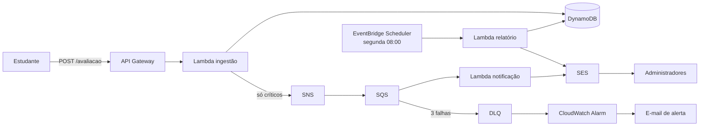

# Plataforma de Feedback de Aulas — Tech Challenge Fase 4

Plataforma serverless na AWS em que estudantes avaliam aulas on-line e administradores recebem alertas automáticos
de feedbacks críticos e um relatório semanal com a média das avaliações. Infraestrutura como código com AWS SAM,
funções em Java 21 e deploy automatizado pelo GitHub Actions.

## Arquitetura



Detalhes, justificativa do modelo serverless e contratos: [docs/arquitetura.md](docs/arquitetura.md).

## Funções

| Função | Gatilho | Responsabilidade |
|---|---|---|
| `tc4-<stage>-ingestion` | `POST /avaliacao` (API Gateway) | Grava o feedback no DynamoDB e publica os críticos no SNS |
| `tc4-<stage>-notification` | Fila SQS de feedbacks críticos | Envia o e-mail de urgência aos administradores pelo SES |
| `tc4-<stage>-weekly-report` | EventBridge Scheduler, segunda 08:00 (Brasília) | Calcula os indicadores da semana e envia o relatório pelo SES |

## Testes locais

Suba o ambiente com Docker Desktop:

```sh
docker compose -f compose.local.yaml up -d --build
```

- API: **POST http://localhost:3000/avaliacao**
- Banco: **http://localhost:8001**
- E-mails: **http://localhost:8025**

O ambiente usa servi?os locais e credenciais fict?cias. O passo a passo completo est? no
[cap?tulo de testes locais](docs/testes-locais.md), e o contrato da API est? na
[documenta??o da ingest?o](docs/ingestao-feedback.md).

## Como fazer deploy

- **Automático (caminho oficial):** push ou merge na `main`, ou **Actions → Deploy → Run workflow**. O GitHub
  Actions assume uma role na AWS via OIDC, roda `sam build` e `sam deploy` na stack `tc4-dev`.
- **Manual (avaliação ou emergência):** pelo AWS CloudShell, com `sam build` e `sam deploy`.

Pré-requisitos, parâmetros, passo a passo e monitoramento: [docs/deploy-e-monitoramento.md](docs/deploy-e-monitoramento.md).

## Como testar

Obtenha a URL e a API Key após o deploy (comandos em [docs/deploy-e-monitoramento.md](docs/deploy-e-monitoramento.md)) e envie:

```bash
curl -i -X POST "<API_URL>" \
  -H "Content-Type: application/json" \
  -H "x-api-key: <API_KEY>" \
  -d '{"descricao": "A aula ficou confusa", "nota": 2}'
```

| Resposta | Significado |
|---|---|
| `2xx` | Feedback aceito |
| `400` | Corpo inválido (`descricao` vazia ou `nota` fora de 0 a 10) |
| `403` | API Key ausente ou inválida |
| `429` | Limite de requisições excedido |

## Estrutura do repositório

```
.
├── template.yaml               # Infraestrutura (AWS SAM): API, funções, tabela, filas, tópicos, alarmes
├── samconfig.toml              # Configuração das stacks tc4-dev e tc4-prod
├── .github/workflows/
│   └── deploy.yml              # Deploy automatizado (GitHub Actions + OIDC)
├── functions/
│   ├── ingestion/              # Lambda de ingestão (Java 21)
│   ├── notification/           # Lambda de notificação (Java 21)
│   └── weekly-report/          # Lambda de relatório semanal (Java 21)
└── docs/
    ├── arquitetura.md
    ├── deploy-e-monitoramento.md
    ├── governanca-aws.md
    ├── notificacao-feedback-critico.md
    ├── proposta-chave-dynamodb.md
    ├── decisoes/               # Registros de decisão (ADR)
    └── img/
```

## Documentação

| Documento | Conteúdo |
|---|---|
| [Arquitetura](docs/arquitetura.md) | Diagrama, modelo de nuvem, funções, componentes, contratos |
| [Deploy e monitoramento](docs/deploy-e-monitoramento.md) | Pré-requisitos, deploy automático e manual, dashboard, alarmes, logs |
| [Segurança e governança](docs/governanca-aws.md) | IAM, MFA, roles por função, API Gateway, auditoria, custos |
| [Notificação de feedback crítico](docs/notificacao-feedback-critico.md) | Fluxo, novas tentativas, DLQ, alarme, testes |
| [Chave do DynamoDB](docs/proposta-chave-dynamodb.md) | Padrões de acesso e modelagem da tabela |
| [ADR-001](docs/decisoes/ADR-001-identidade-email-ses.md) | Identidade de e-mail do SES sem domínio próprio |

## Vídeo de demonstração

_Link a incluir quando o vídeo estiver pronto._
