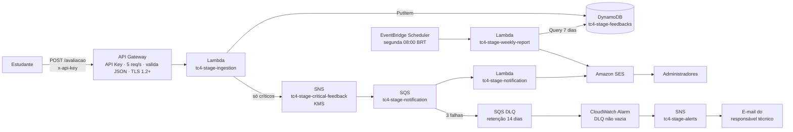
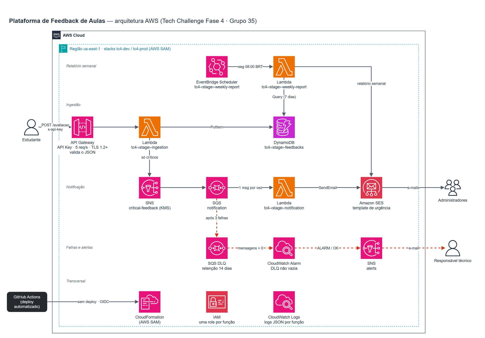

# Arquitetura — Plataforma de Feedback de Aulas

> Tech Challenge Fase 4 — Grupo 35 · Arquitetura da solução, modelo de nuvem escolhido e responsabilidade de cada
> componente. Infraestrutura descrita em [`template.yaml`](../template.yaml) (AWS SAM), região `us-east-1`.

---

## 1. Contexto

Estudantes avaliam as aulas on-line e administradores acompanham a satisfação. O sistema precisa:

- **receber feedbacks** (`POST /avaliacao` com `descricao` e `nota` de 0 a 10);
- **notificar automaticamente** os administradores quando um feedback é crítico (descrição, urgência e data de envio);
- **gerar um relatório semanal** com descrição, urgência, data de envio, quantidade de avaliações por dia e por
  urgência, e a média das notas.

Requisitos não funcionais do enunciado: rodar em nuvem com **serverless** (no mínimo duas funções com responsabilidade
única), segurança dos dados e governança de acesso, componentes de suporte configurados, **deploy automatizado** e
**monitoramento**.

---

## 2. Diagrama





> `stage` é `dev` ou `prod`. Cada ambiente é uma stack separada do CloudFormation (seção 8).

### Fluxos

1. **Ingestão (síncrono).** O API Gateway exige a API Key, aplica o limite de requisições e valida o corpo contra o
   modelo `EvaluationRequest`; payload inválido recebe `400` sem invocar a função. A função de ingestão grava o
   feedback no DynamoDB e, se ele for crítico, publica um evento no tópico SNS. O estudante recebe a resposta sem
   esperar o envio do e-mail.
2. **Notificação (assíncrono).** O SNS entrega o evento na fila SQS. A função de notificação consome a fila (uma
   mensagem por vez), monta o e-mail e envia pelo SES. Se falhar, a mensagem volta para a fila; na 3ª falha vai para
   a DLQ, o alarme dispara e o responsável técnico recebe um e-mail.
3. **Relatório (agendado).** Toda segunda-feira às 08:00 (horário de Brasília) o EventBridge Scheduler invoca a
   função de relatório, que lê os feedbacks dos últimos 7 dias, calcula os indicadores e envia o relatório pelo SES.

---

## 3. Modelo de nuvem e justificativa

| Modelo | O que o grupo administraria | Avaliação para este projeto |
|---|---|---|
| **IaaS** (EC2) | Sistema operacional, patches, runtime, escala, alta disponibilidade | Custo fixo 24 h por dia para um volume baixo e irregular; muita operação |
| **PaaS / contêineres** (Elastic Beanstalk, ECS) | Runtime, imagens, capacidade mínima | Menos operação que IaaS, mas ainda paga por capacidade ociosa |
| **FaaS / serverless** (Lambda + serviços gerenciados) | Apenas o código e a configuração | **Escolhido** |

**Por que AWS Serverless:**

- **Custo por uso.** Lambda, API Gateway, DynamoDB sob demanda, SNS, SQS e SES cobram por requisição; no volume do
  projeto o custo fica próximo de zero e dentro do Free Tier, o que importa num ambiente com créditos limitados.
- **Escala automática** sem configuração de capacidade.
- **Sem servidores para administrar**: a AWS cuida de sistema operacional, patches e disponibilidade.
- **Cobertura 1:1 dos requisitos** por serviços gerenciados: entrada (API Gateway), dados (DynamoDB), eventos
  (SNS/SQS), e-mail (SES), agendamento (EventBridge Scheduler), monitoramento (CloudWatch).
- **Infraestrutura como código** com AWS SAM: o mesmo `template.yaml` cria `dev` e `prod`, e o deploy é automatizado
  pelo GitHub Actions.

**Alternativas descartadas:**

| Alternativa | Motivo |
|---|---|
| EC2 / ECS | Custo fixo e operação de servidores ou cluster |
| RDS (relacional) | Custo por hora, exige VPC; os padrões de acesso são simples e cabem no DynamoDB |
| MongoDB + Jenkins (setup inicial) | Mais componentes para hospedar e manter; substituído por DynamoDB e GitHub Actions |
| Quarkus / GraalVM nativo | Build mais complexo; o cold start do Java é tratado com **SnapStart** no Java 21 puro |

**Runtime:** Java 21 (Amazon Corretto), 512 MB, timeout de 20 s, **SnapStart** em versões publicadas (alias `live`),
o que reduz o cold start sem mudar o código.

---

## 4. Funções

Cada função tem **uma única responsabilidade** e **uma role IAM própria**, com acesso apenas ao que usa.

| Função | Gatilho | Entrada | Saída | Permissões da role | Logs |
|---|---|---|---|---|---|
| `tc4-<stage>-ingestion` | API Gateway `POST /avaliacao` | `{ "descricao", "nota" }` já validado | Item no DynamoDB; evento no SNS se crítico; resposta HTTP | `dynamodb:PutItem` na tabela; `sns:Publish` no tópico crítico; logs | `/aws/lambda/tc4-<stage>-ingestion` |
| `tc4-<stage>-notification` | SQS `tc4-<stage>-notification` (`BatchSize: 1`, `ReportBatchItemFailures`) | Evento de feedback crítico | E-mail aos administradores via SES | `sqs:ReceiveMessage/DeleteMessage/GetQueueAttributes` na fila; `ses:SendEmail` só com o remetente configurado (`ses:FromAddress`); logs | `/aws/lambda/tc4-<stage>-notification` |
| `tc4-<stage>-weekly-report` | EventBridge Scheduler `cron(0 8 ? * MON *)`, fuso `America/Sao_Paulo` | Evento do agendador | Relatório semanal por e-mail via SES | `dynamodb:Query` na tabela; `ses:SendEmail/SendRawEmail` na identidade do remetente; logs | `/aws/lambda/tc4-<stage>-weekly-report` |

Todas as funções escrevem logs em **JSON** num log group criado pelo template, com retenção configurável
(`LogRetentionDays`, padrão 14 dias). Detalhes da notificação em
[`notificacao-feedback-critico.md`](notificacao-feedback-critico.md).

> **Estado na branch `ci/deploy-workflow`:** a notificação está implementada; a ingestão e o relatório ainda são
> *placeholders* (devolvem `202` e só registram log). Atualizar esta seção quando as implementações entrarem.

---

## 5. Componentes de suporte

| Componente | Configuração | Por quê |
|---|---|---|
| **DynamoDB** `tc4-<stage>-feedbacks` | Sob demanda (`PAY_PER_REQUEST`); chave `pk = DAY#<data>`, `sk = <timestamp>#<id>`; criptografia em repouso padrão; proteção contra exclusão em `prod` | Paga só pelo uso; a chave atende ingestão e relatório sem `Scan` ([proposta da chave](proposta-chave-dynamodb.md)) |
| **SNS** `tc4-<stage>-critical-feedback` | Criptografia com `alias/aws/sns` | Desacopla a ingestão da notificação; novos consumidores podem ser inscritos sem alterar a ingestão |
| **SQS** `tc4-<stage>-notification` | `VisibilityTimeout` 120 s, SSE gerenciada, redrive para a DLQ após 3 recebimentos; só o tópico crítico pode enviar | Guarda o evento até o e-mail sair e permite novas tentativas |
| **SQS DLQ** `tc4-<stage>-notification-dlq` | Retenção de 14 dias (máximo) | Nenhum feedback crítico é perdido; dá tempo para investigar e reprocessar |
| **CloudWatch Alarm** `tc4-<stage>-notification-dlq-not-empty` | `ApproximateNumberOfMessagesVisible > 0` por 1 min; avisa em `ALARM` e em `OK` | Alerta automático de falha de notificação |
| **SNS** `tc4-<stage>-alerts` | Inscrição por e-mail opcional (`AlertEmail`) | Entrega os alertas operacionais ao responsável técnico |
| **Amazon SES** | Identidade de e-mail verificada (sem domínio próprio, [ADR-001](decisoes/ADR-001-identidade-email-ses.md)); template de e-mail de feedback crítico (protótipo validado; entra no `template.yaml` na issue #3); conta em **sandbox** | Envio de e-mail gerenciado; no sandbox só se envia para endereços verificados (limite de 200/dia) |
| **EventBridge Scheduler** `tc4-<stage>-weekly-report` | Segunda-feira 08:00, fuso de Brasília | Agendamento gerenciado com fuso horário, sem ajuste manual de horário de verão |

**Sem VPC.** Nenhum componente precisa de rede privada: DynamoDB, SNS, SQS e SES são acessados por endpoints
HTTPS da AWS, autorizados por IAM. Isso evita o custo de NAT Gateway e o cold start extra de Lambdas em VPC.

---

## 6. Contratos

### 6.1 Entrada — `POST /avaliacao`

Cabeçalho obrigatório: `x-api-key: <API_KEY>`.

```json
{ "descricao": "A aula ficou confusa", "nota": 3 }
```

| Campo | Tipo | Regra (validada no API Gateway) |
|---|---|---|
| `descricao` | string | Obrigatório, 1 a 1000 caracteres |
| `nota` | inteiro | Obrigatório, 0 a 10 |

| Resposta | Quando |
|---|---|
| `2xx` | Feedback aceito |
| `400` | Corpo inválido (campo ausente, tipo errado, fora do intervalo) |
| `403` | API Key ausente ou inválida |
| `429` | Limite de requisições ou cota diária excedidos |

### 6.2 Item no DynamoDB

| Atributo | Exemplo |
|---|---|
| `pk` | `DAY#2026-10-29` |
| `sk` | `2026-10-29T14:03:12.123Z#7f3c…` |
| `id` | `7f3c…` (UUID) |
| `description` | `"A aula ficou confusa"` |
| `rating` | `3` |
| `urgency` | `CRITICAL` |
| `createdAt` | `2026-10-29T14:03:12.123Z` |

### 6.3 Evento de feedback crítico (SNS → SQS)

```json
{
  "id": "7f3c2a10-5b1e-4c3d-9a8f-0e6b2d4c1a99",
  "descricao": "Aula com áudio inaudível",
  "nota": 2,
  "urgencia": "CRITICAL",
  "dataEnvio": "2026-11-10T14:30:00Z"
}
```

Entregue sem envelope na fila (`RawMessageDelivery`). Campos extras são ignorados pela notificação. Detalhes em
[`notificacao-feedback-critico.md`](notificacao-feedback-critico.md#2-contrato-do-evento).

> **A alinhar:** o critério de urgência (proposta: `nota <= 3` → `CRITICAL`) e o valor do campo `urgencia`
> (`CRITICAL` aqui e no DynamoDB; `ALTA` no exemplo da notificação) precisam ser iguais na ingestão, na notificação e
> no relatório.

---

## 7. Segurança e governança

Resumo; detalhes e evidências em [`governanca-aws.md`](governanca-aws.md).

- **Acesso humano:** usuários IAM no grupo `Admins`, MFA obrigatório (política `RequireMFA`), sem access keys
  para pessoas, root sem uso diário.
- **Acesso das funções:** uma role por função, menor privilégio (seção 4).
- **Acesso do pipeline:** GitHub Actions assume uma role via **OIDC**, sem chaves de longa duração.
- **Porta de entrada:** API Key, usage plan (5 req/s, rajada de 10, 1000 req/dia), validação do corpo e TLS 1.2+
  (`SecurityPolicy_TLS12_PFS_2025_EDGE`).
- **Dados:** criptografia em repouso no DynamoDB, SNS e SQS; em trânsito por HTTPS.
- **Segredos:** nenhum e-mail, ID de conta ou API Key no repositório; valores sensíveis entram como parâmetros do
  deploy (secrets do GitHub).
- **Auditoria e custo:** CloudTrail, logs estruturados no CloudWatch e AWS Budgets com alertas.

---

## 8. Ambientes, limitações e evoluções

| Ambiente | Stack | Observação |
|---|---|---|
| `dev` | `tc4-dev` | Implantado automaticamente pelo GitHub Actions a cada push na `main`. **Compartilhado:** o último `sam deploy` vale |
| `prod` | `tc4-prod` | Configurado em `samconfig.toml`; proteção contra exclusão na tabela |

Instruções de deploy e monitoramento: [`deploy-e-monitoramento.md`](deploy-e-monitoramento.md).

**Limitações conhecidas e evoluções:**

| Limitação | Evolução |
|---|---|
| Autenticação só por API Key (identifica o cliente, não o estudante) | JWT com Amazon Cognito |
| SES em sandbox, sem domínio próprio (risco de spam, só destinatários verificados) | Domínio próprio com Easy DKIM e pedido de acesso de produção |
| Sem backup contínuo da tabela | Habilitar PITR em `prod` |
| Tópico de alertas sem criptografia (o CloudWatch não publica com `alias/aws/sns`) | Chave KMS própria, se o custo for aceito |
