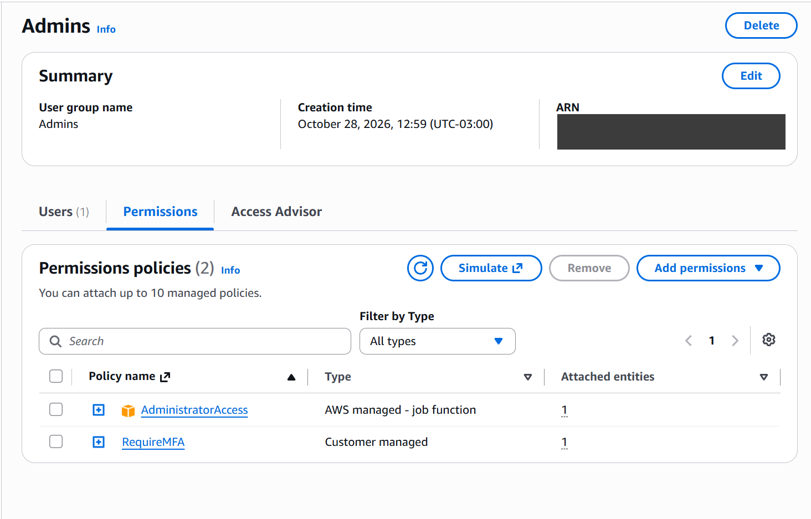
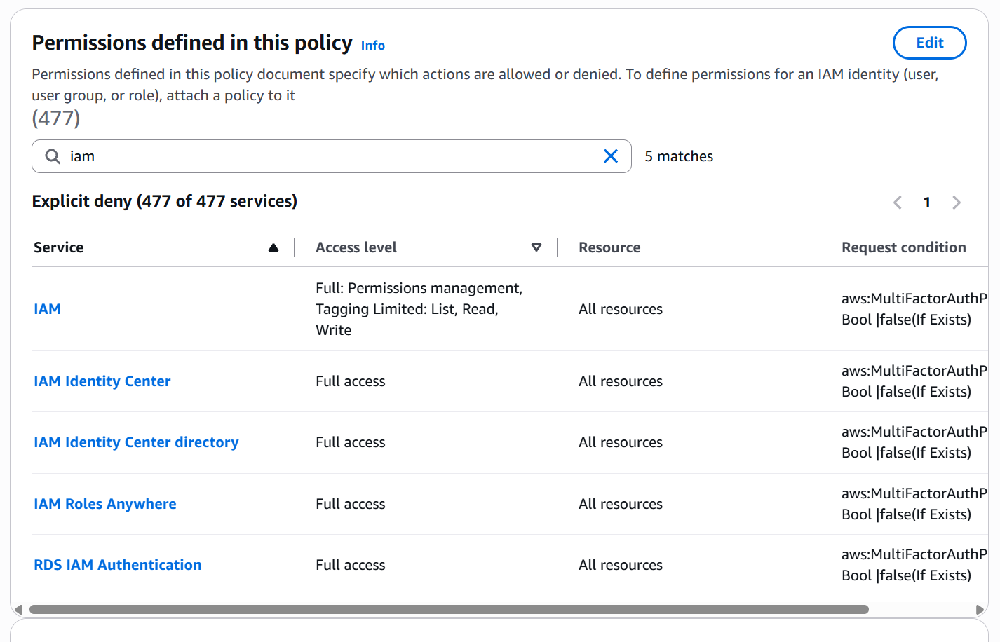
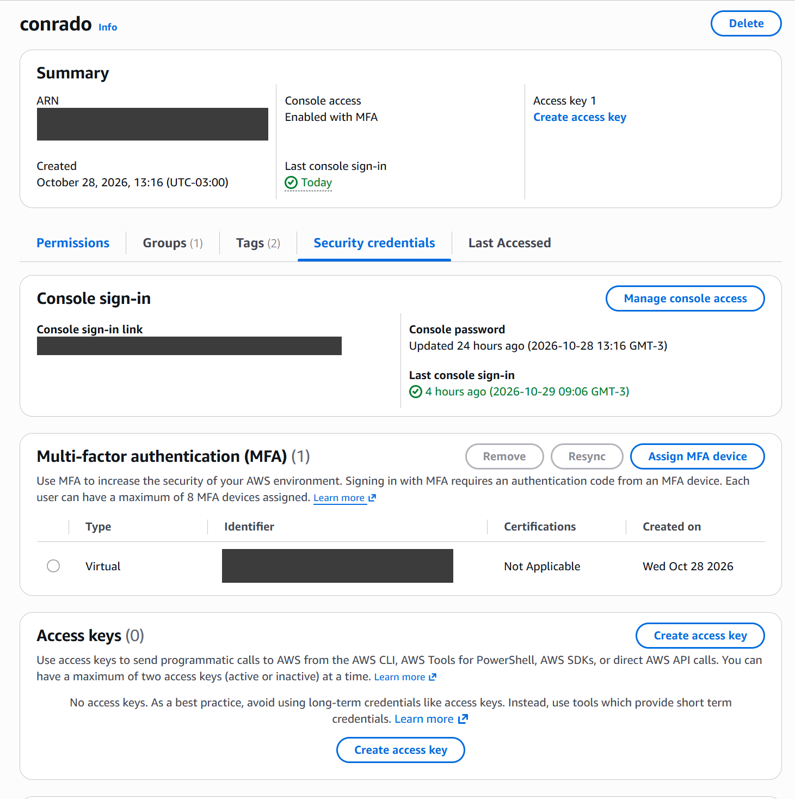
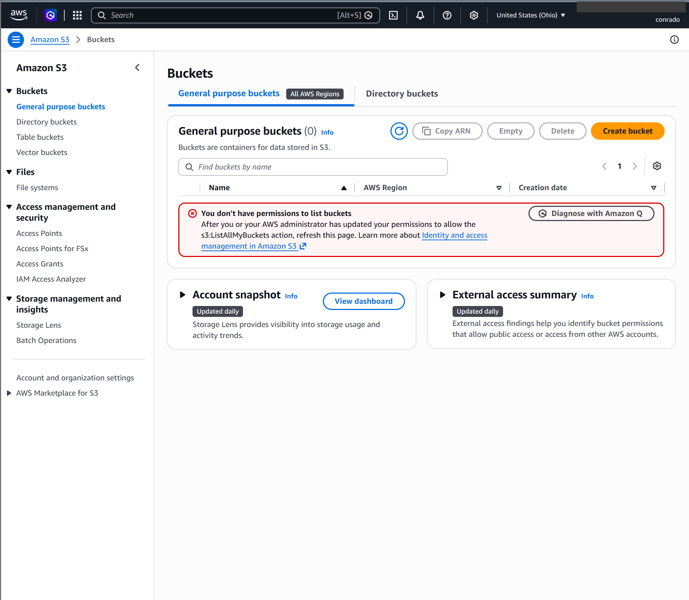
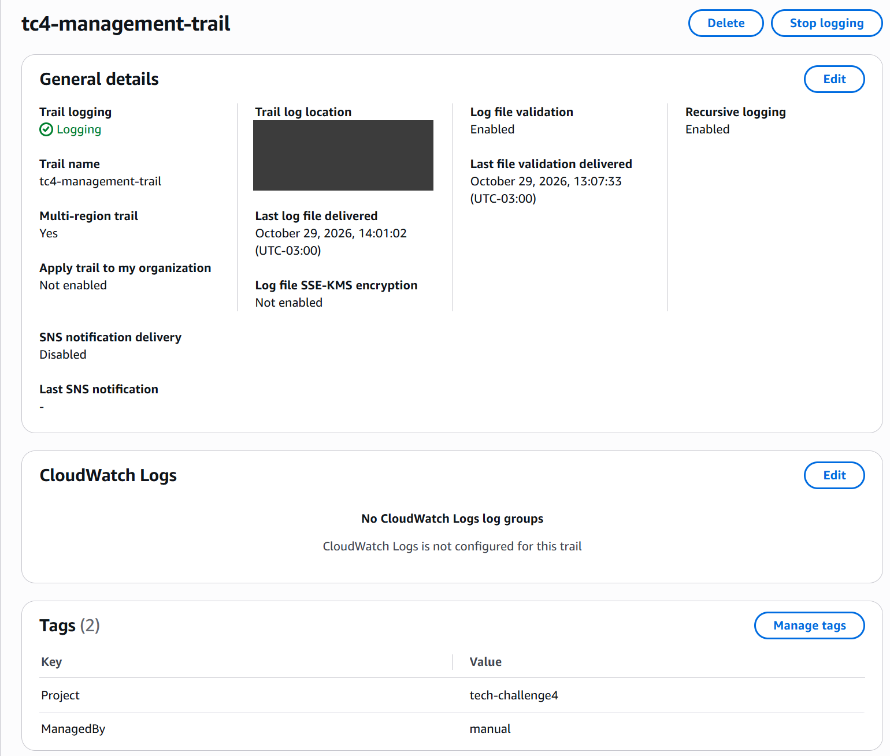
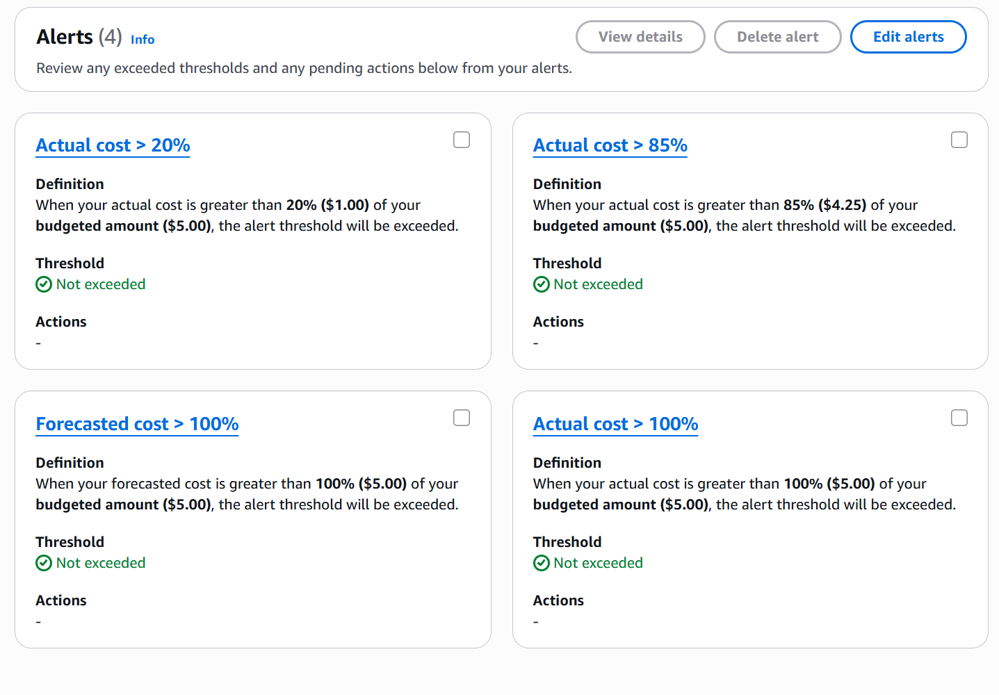

# Segurança e Governança de Acesso — AWS

> Tech Challenge Fase 4 — Grupo 35 · Issue #1 (Infraestrutura): *Provisionar ambiente de nuvem com segurança e governança de acesso*.

Este documento descreve como a conta AWS que hospeda a plataforma de feedback foi configurada, quem pode acessar o quê
e por quê. Cada item indica seu estado:

- ✅ **Implementado** — já configurado na conta.
- 🔜 **Planejado** — definido aqui e implementado via IaC (AWS SAM) junto com as funções.

---

## 1. Visão geral

| Decisão | Escolha | Motivo |
|---|---|---|
| Provedor | **AWS** | Serviços serverless que cobrem 1:1 os requisitos (Lambda, API Gateway, DynamoDB, SNS/SQS, SES, EventBridge, CloudWatch) |
| Região | **us-east-1** (N. Virginia) | Todos os serviços disponíveis e menor custo |
| Modelo | **Serverless** | Sem servidores para administrar, cobrança por uso, escala automática |
| Banco de dados | **DynamoDB** | Gerenciado, criptografado por padrão, acesso controlado por IAM — não precisa de VPC nem fica exposto na internet |
| IaC | **AWS SAM** (CloudFormation) | Infraestrutura versionada no repositório, deploy reproduzível e rollback automático |
| CI/CD | **GitHub Actions** com OIDC | Gratuito para repositório público e sem chave de acesso armazenada (ver seção 6) |

Arquitetura alvo (resumida):

```
Aluno ──POST /avaliacao──> API Gateway (API Key + Usage Plan)
                               │
                               ▼
                     Lambda Ingestão ──> DynamoDB (feedbacks)
                               │ (feedback crítico)
                               ▼
                          SNS / SQS ──> Lambda Notificação ──> SES (e-mail aos administradores)
                                             └─ DLQ (falhas)

EventBridge Scheduler (semanal) ──> Lambda Relatório ──> DynamoDB (leitura) ──> SES
CloudWatch: logs, métricas e alarmes de todas as funções · CloudTrail: auditoria da conta
```

---

## 2. Modelo de responsabilidade compartilhada

Na nuvem, a segurança é dividida entre o provedor e o cliente. Em uma arquitetura serverless, a AWS assume uma parte
maior do que em servidores próprios (EC2), mas a configuração de acesso e os dados continuam sendo do grupo.

| Camada | Responsável | No nosso projeto |
|---|---|---|
| Data centers, hardware, rede física | AWS | — |
| Virtualização e isolamento entre clientes | AWS | Cada execução de Lambda roda em uma microVM isolada (Firecracker) |
| Sistema operacional e runtime das funções | AWS | Runtime gerenciado `java21`, com patches aplicados pela AWS (por isso o pacote é `.zip` e não imagem de container) |
| Disponibilidade e criptografia em repouso dos serviços gerenciados | AWS | DynamoDB, SQS e SNS criptografam os dados em repouso por padrão |
| **Identidades e permissões (IAM)** | **Grupo** | Usuários com MFA, uma role mínima por função (seções 4 e 5) |
| **Exposição da API** | **Grupo** | API Gateway com API Key e limite de requisições (seção 7) |
| **Dados e sua classificação** | **Grupo** | Feedbacks no DynamoDB, acessíveis só pelas funções autorizadas |
| **Código das funções e dependências** | **Grupo** | Validação de entrada, tratamento de erros, dependências atualizadas |
| **Segredos e credenciais** | **Grupo** | Nenhuma credencial no repositório (seção 8) |
| **Monitoramento e auditoria** | **Grupo** | CloudTrail, CloudWatch e Budget (seções 9 e 10) |

---

## 3. Conta e usuário root ✅

O usuário *root* (o e-mail que criou a conta) tem poder total e não pode ser limitado por políticas IAM. Por isso:

- **MFA ativado** no root (aplicativo autenticador TOTP).
- **Sem access keys** no root.
- O root **não é usado no dia a dia** — apenas para tarefas que só ele pode fazer (ex.: faturamento, fechar a conta).
- **Acesso ao Billing liberado para usuários IAM** (*IAM user and role access to Billing information*), para que a
  administração de custos não exija o root.

Optou-se por **uma única conta**, sem AWS Organizations: Organizations e IAM Identity Center não são necessários para o
tamanho do projeto e alteram o plano de cobrança da conta. A segregação de ambientes é feita por stage (seção 11).

---

## 4. Acesso humano: usuários, grupo e MFA ✅

### 4.1 Grupo `Admins`

Cada integrante tem seu **próprio usuário IAM** (sem compartilhamento de login), e todos ficam no grupo `Admins`.
As permissões são atribuídas ao **grupo**, nunca diretamente ao usuário — incluir ou remover alguém é só mudar a
participação no grupo.

| Política anexada ao grupo | Efeito |
|---|---|
| `AdministratorAccess` (gerenciada pela AWS) | Acesso total aos serviços |
| `RequireMFA` (criada pelo grupo) | Nega **tudo** quando a sessão não tem MFA (ver 4.2) |



> **Por que todos são administradores?** O grupo trabalha sem hierarquia e todos precisam criar e depurar recursos.
> O risco é compensado por MFA obrigatório, ausência de chaves fixas, CloudTrail e alertas de custo. Em uma empresa, os
> perfis seriam separados (ex.: `Admin`, `Developer`, `ReadOnly`). O **menor privilégio é aplicado rigorosamente nas
> identidades das máquinas** (funções Lambda e pipeline — seções 5 e 6).

### 4.2 Política `RequireMFA`

Política de **negação explícita**: enquanto o usuário não se autentica com MFA, só consegue cadastrar o próprio MFA e
trocar a própria senha. Qualquer outra ação é negada — **inclusive** as liberadas pelo `AdministratorAccess`, porque no
IAM um `Deny` explícito sempre vence um `Allow`.

```json
{
    "Version": "2012-10-17",
    "Statement": [
        {
            "Sid": "DenyAllExceptMfaSetupIfNoMFA",
            "Effect": "Deny",
            "NotAction": [
                "iam:CreateVirtualMFADevice",
                "iam:EnableMFADevice",
                "iam:GetUser",
                "iam:GetMFADevice",
                "iam:ListMFADevices",
                "iam:ListVirtualMFADevices",
                "iam:ResyncMFADevice",
                "iam:ChangePassword",
                "iam:GetAccountPasswordPolicy",
                "sts:GetSessionToken"
            ],
            "Resource": "*",
            "Condition": {
                "BoolIfExists": {
                    "aws:MultiFactorAuthPresent": "false"
                }
            }
        }
    ]
}
```

Como funciona:

- `"Effect": "Deny"` + `NotAction`: nega **todas as ações exceto** as listadas, que são só as necessárias para:
  - cadastrar e sincronizar o próprio MFA (`CreateVirtualMFADevice`, `EnableMFADevice`, `ResyncMFADevice` e as
    leituras `GetUser`, `GetMFADevice`, `ListMFADevices`, `ListVirtualMFADevices`);
  - trocar a própria senha no primeiro acesso (`ChangePassword`, `GetAccountPasswordPolicy`);
  - obter uma sessão temporária autenticada com MFA (`sts:GetSessionToken`).
- `BoolIfExists` / `aws:MultiFactorAuthPresent = false`: a negação só se aplica quando a sessão **não** tem MFA.
  O `IfExists` cobre também requisições em que a chave não está presente (ex.: chamadas com access key de longa
  duração), que são negadas.



### 4.3 Política de senha da conta

- Mínimo de **14 caracteres**, com maiúscula, minúscula, número e símbolo.
- Não reutilizar as **5 últimas** senhas.

### 4.4 Sem access keys para pessoas

Usuários humanos **não possuem access keys** (chaves de longa duração). O acesso pela linha de comando é feito com
`aws login`, que abre o navegador, exige senha + MFA e gera **credenciais temporárias** (válidas por até 12 h). Nada fica
salvo no disco que permita acesso permanente.

Motivo adicional: a `RequireMFA` precisa permitir o cadastro de MFA *sem* MFA (senão um usuário novo nunca conseguiria
ativá-lo). Se um usuário tivesse uma access key e ela vazasse, um atacante poderia cadastrar o próprio MFA e obter
acesso de administrador. Sem access keys, esse caminho não existe.



### 4.5 Validação realizada

| Teste | Resultado esperado | Resultado |
|---|---|---|
| Login sem MFA → listar buckets S3 | Acesso negado | ✅ `You don't have permissions to list buckets` |
| Login com MFA → listar buckets e abrir Billing | Acesso liberado | ✅ |
| CLI via `aws login` → `aws s3 ls` | Lista os buckets | ✅ |



---

## 5. Acesso das funções: uma role por função 🔜

Cada função Lambda recebe sua **própria role IAM** (o "crachá" com que ela acessa outros serviços), com **apenas as ações
necessárias e apenas nos recursos dela** — nunca `*`. As roles são criadas pelo template SAM, de modo que ficam
versionadas e revisáveis no repositório.

| Função | Pode fazer | Em qual recurso |
|---|---|---|
| **Ingestão** — `POST /avaliacao` | `dynamodb:PutItem` · `sns:Publish` | Tabela de feedbacks · tópico de feedback crítico |
| **Notificação** | `sqs:ReceiveMessage`, `sqs:DeleteMessage`, `sqs:GetQueueAttributes` · `ses:SendEmail` | Fila de notificações · identidade de e-mail verificada |
| **Relatório semanal** | `dynamodb:Query` / `dynamodb:Scan` · `ses:SendEmail` | Tabela de feedbacks · identidade de e-mail verificada |
| Todas | `logs:CreateLogStream`, `logs:PutLogEvents` | O próprio log group |

Consequências práticas:

- A função de notificação **não consegue ler nem alterar** a tabela de feedbacks.
- A função de relatório **não consegue gravar** na tabela.
- Uma falha ou vulnerabilidade em uma função fica restrita ao que aquela role permite.
- O DynamoDB fica **acessível apenas pelas funções autorizadas**, controlado por IAM, sem precisar de VPC.

No SAM, isso é declarado com *policy templates* com escopo de recurso, por exemplo
`DynamoDBWritePolicy: { TableName: !Ref FeedbackTable }`.

---

## 6. Acesso do pipeline (GitHub Actions) 🔜

O deploy automatizado **não usa access keys** guardadas nos *secrets* do GitHub. O GitHub Actions se autentica via
**OIDC**:

1. A conta AWS confia no provedor de identidade do GitHub (`token.actions.githubusercontent.com`).
2. Uma role de deploy só pode ser assumida por workflows **deste repositório** e da **branch `main`** (condição na trust
   policy).
3. A cada execução, o GitHub recebe **credenciais temporárias** dessa role, que expiram ao fim do job.

Assim não existe chave de longa duração que possa vazar. Em caso de falha no deploy, o CloudFormation faz **rollback
automático** da stack para a última versão estável.

---

## 7. Porta de entrada: API Gateway 🔜

O **API Gateway** é a **única porta de entrada** da aplicação. As funções não têm URL pública própria (sem *Function URL*).

| Controle | Como |
|---|---|
| Autenticação | **API Key** obrigatória no header `x-api-key` |
| Rate limiting | **Usage Plan** com *throttling* (requisições/segundo e rajada) e **quota** diária |
| Validação | Request validator do API Gateway para rejeitar payloads malformados antes de invocar a função |
| Criptografia em trânsito | Somente HTTPS (padrão do API Gateway) |

A API Key não é segredo forte (identifica o cliente e permite limitar o uso). Ela não é versionada no repositório: é
obtida no console ou via CLI por quem tem acesso à conta.

---

## 8. Segredos e credenciais no repositório ✅

**Nenhuma credencial sensível é versionada.** Como o repositório é público:

- Não existem access keys de usuários (seção 4.4) nem do pipeline (seção 6) — portanto, não há chave para vazar.
- `.gitignore` bloqueia `.env`, `.env.*`, `*.pem`, `*.key` e artefatos de build (`.aws-sam/`, `target/`).
- Configurações não sensíveis (nome de tabela, ARN do tópico) são passadas às funções como **variáveis de ambiente**
  geradas pelo próprio template.
- Valores sensíveis, se surgirem, vão para o **SSM Parameter Store** (`SecureString`), lidos pela função em tempo de
  execução — nunca no código.
- Evidências publicadas (prints) têm o ID da conta ocultado.

---

## 9. Auditoria: CloudTrail ✅

| Configuração | Valor |
|---|---|
| Trail | `tc4-management-trail` |
| Abrangência | **Multi-região** (registra atividade em qualquer região, inclusive as que não usamos) |
| Eventos | *Management events* — leitura e escrita |
| Armazenamento | Bucket S3 dedicado, criptografado (SSE-S3) |
| Integridade | **Log file validation** ligado — permite provar que os registros não foram alterados |

O CloudTrail registra **quem** fez **o quê**, **quando** e **de onde** (login no console, criação/remoção de recursos,
mudanças de permissão). A primeira trilha de management events não tem custo; paga-se apenas o armazenamento no S3.



---

## 10. Controle de custos: AWS Budgets ✅

Orçamento mensal de **US$ 5**, com alertas por e-mail:

| Alerta | Tipo | Finalidade |
|---|---|---|
| 20% (US$ 1,00) | Gasto real | Aviso antecipado: algo começou a gerar custo |
| 85% (US$ 4,25) | Gasto real | Próximo do limite |
| 100% (US$ 5,00) | Gasto previsto | A projeção do mês vai estourar o orçamento |
| 100% (US$ 5,00) | Gasto real | Orçamento estourado |



Além do alerta, os recursos são escolhidos para caber no nível gratuito permanente (Lambda, DynamoDB, SNS, SQS,
CloudWatch). São evitados recursos com custo fixo por hora: EC2, NAT Gateway, RDS, IPv4 público e funções em VPC.

Todos os recursos recebem as tags `Project=tech-challenge4` e `ManagedBy=<sam|manual>`, o que permite filtrar os custos
do projeto no Cost Explorer.

---

## 11. Segregação de ambientes 🔜

Contas separadas por ambiente (via AWS Organizations) seriam o ideal em uma empresa, mas são desproporcionais para o
projeto. A segregação é feita **por stage no IaC**: o mesmo template é implantado como **stacks independentes**
(`dev` e `prod`), com recursos prefixados pelo nome do stage. Um deploy em `dev` não altera nem acessa os recursos de
`prod`, e cada função só recebe permissão sobre os recursos do próprio stage.

---

## 12. Resumo dos controles

| Controle | Estado |
|---|---|
| MFA no root, root sem access keys | ✅ |
| Usuários IAM individuais no grupo `Admins` | ✅ |
| MFA obrigatório (`RequireMFA`) | ✅ |
| Política de senha forte | ✅ |
| Sem access keys para pessoas (`aws login`) | ✅ |
| CloudTrail multi-região com validação de integridade | ✅ |
| Budget com alertas | ✅ |
| Nenhuma credencial no repositório | ✅ |
| Uma role mínima por função | 🔜 |
| API Gateway com API Key + Usage Plan | 🔜 |
| Pipeline com OIDC (sem chaves) | 🔜 |
| Stages `dev` / `prod` | 🔜 |
