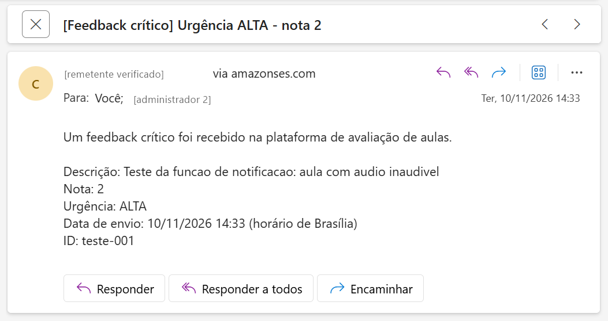
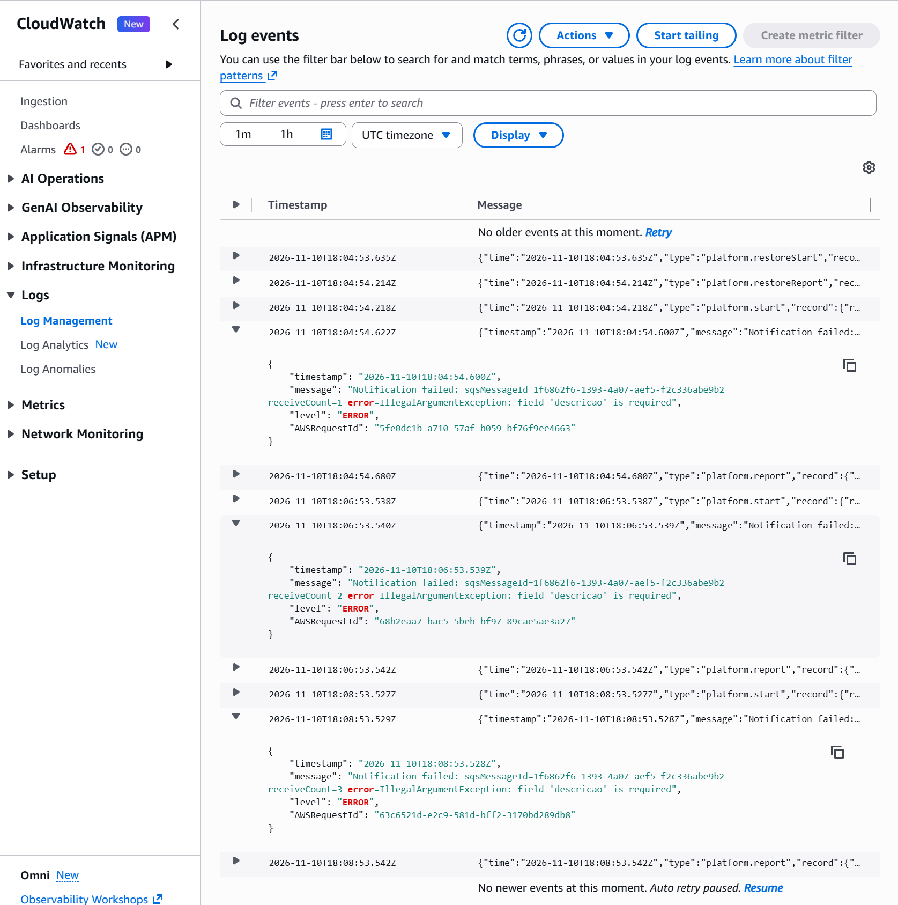
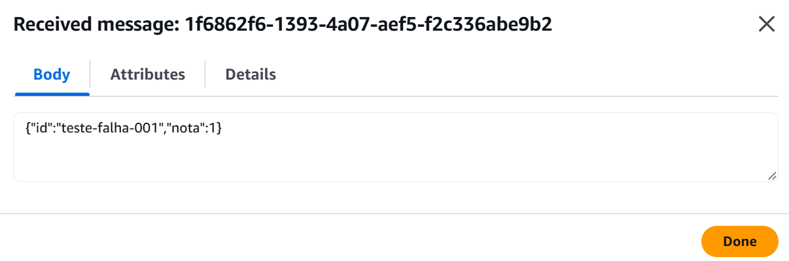
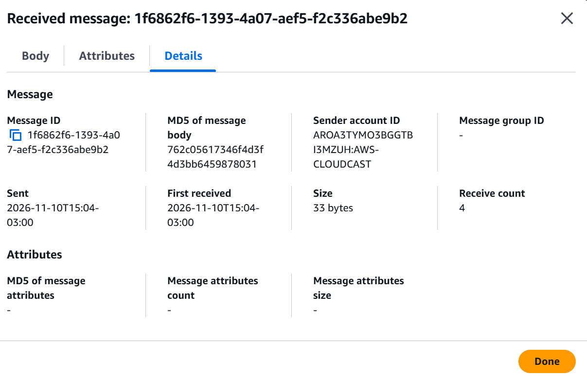
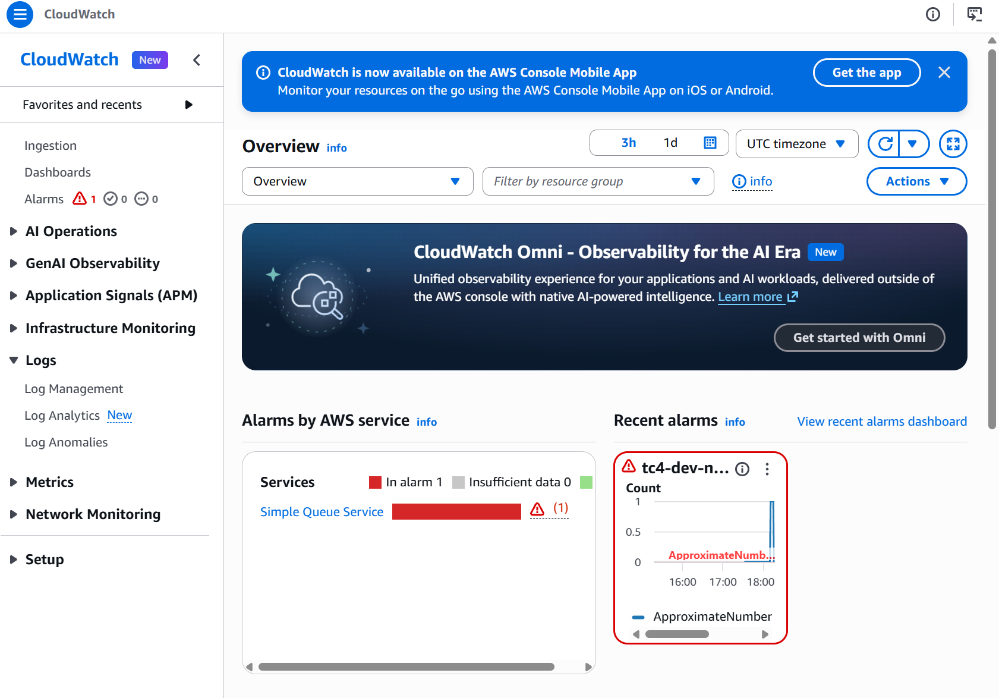

# Notificação de Feedback Crítico

> Tech Challenge Fase 4 — Grupo 35 · Função de notificação de feedbacks críticos e
> fluxo evento → notificação com retry, DLQ e alarme.

Quando um aluno envia uma avaliação crítica, os administradores recebem um e-mail. Este documento descreve
como esse e-mail é gerado, o que acontece quando o envio falha e como testar o fluxo.

---

## 1. Visão geral

```
Aluno ──► Lambda Ingestão ──┬──► DynamoDB (todas as avaliações)
                            │
                            └──► SNS tc4-<stage>-critical-feedback   (só as críticas)
                                      │  inscrição (RawMessageDelivery)
                                      ▼
                                 SQS tc4-<stage>-notification
                                      │  gatilho da Lambda (Event Source Mapping)
                                      ▼
                                 Lambda tc4-<stage>-notification ──► SES ──► e-mail aos administradores
                                      │
                                      └─ falhou 3 vezes ──► SQS tc4-<stage>-notification-dlq ──► alarme CloudWatch
```

| Peça | Papel |
|---|---|
| **Tópico SNS** | Ponto de publicação da ingestão. A ingestão só conhece o tópico, não a fila nem a função de notificação |
| **Fila SQS** | Guarda o evento até a notificação conseguir enviar o e-mail. Permite novas tentativas sem perder o evento |
| **Lambda de notificação** | Lê o evento, monta o e-mail e envia pelo SES |
| **DLQ** | Recebe os eventos que falharam em todas as tentativas, para investigação |
| **Alarme** | Avisa quando existe qualquer evento na DLQ |

A separação por tópico e fila permite que a ingestão responda ao aluno sem esperar o e-mail e que novos
consumidores sejam inscritos no tópico sem alterar a ingestão.

---

## 2. Contrato do evento

A ingestão publica no tópico um JSON com os campos abaixo. Os nomes seguem o contrato em português do `POST /avaliacao`.

```json
{
  "id": "7f3c2a10-5b1e-4c3d-9a8f-0e6b2d4c1a99",
  "descricao": "Aula com áudio inaudível",
  "nota": 2,
  "urgencia": "ALTA",
  "dataEnvio": "2026-11-10T14:30:00Z"
}
```

| Campo | Tipo | Obrigatório | Observação |
|---|---|---|---|
| `id` | string | não | Identificador do feedback gravado no DynamoDB. Aparece no e-mail e nos logs |
| `descricao` | string | **sim** | Texto enviado pelo aluno |
| `nota` | inteiro | **sim** | 0 a 10 |
| `urgencia` | string | **sim** | Classificação definida pela ingestão (ex.: `ALTA`) |
| `dataEnvio` | string | **sim** | Data e hora em ISO-8601 UTC. O e-mail mostra no horário de Brasília |

Campos extras são ignorados, então a ingestão pode acrescentar informações sem quebrar a notificação.
Um evento sem algum campo obrigatório é tratado como falha (seção 4).

---

## 3. Caminho de sucesso

1. A ingestão publica o evento no tópico SNS.
2. O SNS entrega o JSON na fila (sem envelope, por causa do `RawMessageDelivery`).
3. O serviço Lambda lê a fila e chama a função de notificação com a mensagem (`BatchSize: 1`).
4. A função converte o JSON, valida os campos, monta o e-mail e envia pelo SES (API v2).
5. A função loga `Notification sent` com nível `INFO` e o ID do envio no SES.
6. Como a mensagem não foi reportada como falha, o serviço Lambda a apaga da fila.

E-mail recebido no teste em dev (endereços ocultados):



---

## 4. Caminho de falha: novas tentativas, DLQ e alarme

Qualquer erro no processamento de uma mensagem (JSON inválido, campo obrigatório ausente, erro ou limite do SES)
é tratado da mesma forma:

1. A função loga `Notification failed` com nível `ERROR`, o motivo e o número da tentativa (`receiveCount`).
2. A função devolve o ID da mensagem em `batchItemFailures` (`ReportBatchItemFailures` habilitado no gatilho).
   Só a mensagem que falhou volta para a fila; as demais do lote são confirmadas.
3. A mensagem fica invisível até o fim do `VisibilityTimeout` (120 s) e então é entregue de novo.
4. Ao exceder `maxReceiveCount` (3), o SQS move a mensagem para a DLQ, onde ela fica por até 14 dias.
5. O alarme `tc4-<stage>-notification-dlq-not-empty` entra em `ALARM` quando a DLQ tem ao menos uma mensagem.

| Configuração | Valor | Onde |
|---|---|---|
| `VisibilityTimeout` | 120 s (≥ 6× o timeout da função) | `NotificationQueue` |
| `maxReceiveCount` | 3 | `NotificationQueue.RedrivePolicy` |
| Retenção da DLQ | 14 dias | `NotificationDLQ` |
| Alarme | `ApproximateNumberOfMessagesVisible` da DLQ > 0, período de 60 s | `NotificationDLQAlarm` |

### Teste executado em dev (10/11/2026)

Evento publicado no tópico sem os campos obrigatórios: `{"id":"teste-falha-001","nota":1}`.

| Horário (UTC) | Evento |
|---|---|
| 18:04:54 | Tentativa 1 — `receiveCount=1 error=IllegalArgumentException: field 'descricao' is required` |
| 18:06:53 | Tentativa 2 — `receiveCount=2` |
| 18:08:53 | Tentativa 3 — `receiveCount=3` |
| ~18:11 | Mensagem movida para a DLQ (fila principal: 0, DLQ: 1) |
| 18:13:38 | Alarme em `ALARM` |

Logs das três tentativas:



Mensagem na DLQ:





Alarme disparado:



### O que fazer quando o alarme disparar

1. Abrir os logs da função (`/aws/lambda/tc4-<stage>-notification`) e filtrar por `ERROR` para ver o motivo.
2. Corrigir a causa (dado inválido na ingestão, identidade do SES, permissão etc.).
3. No console do SQS, abrir a DLQ e usar **Start DLQ redrive** para devolver as mensagens à fila principal.
   Se a mensagem não tiver como ser reprocessada, usar **Purge** depois de registrar o conteúdo.
4. Com a DLQ vazia, o alarme volta para `OK` em alguns minutos.

---

## 5. Configuração e permissões

### Parâmetros do deploy

| Parâmetro SAM | Variável na função | Descrição |
|---|---|---|
| `SenderEmail` | `SENDER_EMAIL` | Remetente, verificado no SES |
| `RecipientEmails` | `RECIPIENT_EMAILS` | Administradores, separados por vírgula e sem espaço |

Os e-mails não ficam no `samconfig.toml` (versionado). São informados no deploy:

```powershell
sam build
sam deploy --parameter-overrides "Stage=dev SenderEmail=<remetente> RecipientEmails=<admin1>,<admin2>"
```

Se alguma das variáveis estiver vazia, a função falha na inicialização com uma mensagem indicando qual falta.

### SES em sandbox

A conta está no sandbox do SES: o remetente **e todos os destinatários** precisam estar verificados
(SES → Identities). Os endereços de teste do grupo foram verificados individualmente.

### Permissões da função (`NotificationRole`)

| Permissão | Recurso | Motivo |
|---|---|---|
| `logs:CreateLogStream`, `logs:PutLogEvents` | log group da função | Gravar logs |
| `sqs:ReceiveMessage`, `sqs:DeleteMessage`, `sqs:GetQueueAttributes` | fila de notificação | Consumir a fila |
| `ses:SendEmail` | identidades SES da conta, com condição `ses:FromAddress = SenderEmail` | Enviar e-mail apenas como o remetente configurado |

O recurso cobre as identidades da conta, e não só a do remetente, por precaução: no sandbox, os destinatários também
são identidades verificadas, e o SES pode conferir a permissão contra elas. Essa configuração foi validada no teste em
dev; a alternativa restrita à identidade do remetente não foi testada. A condição `ses:FromAddress` impede que a
função envie em nome de outro endereço. A função não tem permissão de escrita
na DLQ: quem move a mensagem é o próprio SQS.

---

## 6. Logs

A função usa o formato de log JSON da Lambda. Cada linha tem `level` (`INFO` ou `ERROR`) e uma mensagem com:

| Campo | Uso |
|---|---|
| `sqsMessageId` | Seguir a mesma mensagem entre as tentativas |
| `feedbackId` | Relacionar com o registro no DynamoDB |
| `sesMessageId` | Comprovar que o SES aceitou o envio |
| `receiveCount` | Saber quantas tentativas já ocorreram |
| `error` | Tipo e mensagem do erro |

O texto da `descricao` não é logado, por ser conteúdo livre do aluno.

Consulta pelo terminal:

```powershell
aws logs tail /aws/lambda/tc4-dev-notification --region us-east-1 --since 10m --format short
```

---

## 7. Como testar manualmente

Enquanto a ingestão não publica eventos, o fluxo pode ser exercitado publicando direto no tópico.

**Console:** SNS → Topics → `tc4-dev-critical-feedback` → **Publish message**, com o JSON da seção 2 no corpo.

**Terminal:**

```powershell
'{"id":"teste-001","descricao":"Teste manual","nota":1,"urgencia":"ALTA","dataEnvio":"2026-11-10T18:00:00Z"}' | Out-File -Encoding ascii msg.json
aws sns publish --region us-east-1 --topic-arn <ARN do tópico> --message file://msg.json
```

Para testar o caminho de falha, publicar um JSON sem `descricao` e acompanhar os logs, a DLQ e o alarme
(cerca de 10 minutos no total).

---

## 8. Limitações conhecidas

| Item | Situação |
|---|---|
| E-mail no spam | O remetente é um endereço `@hotmail.com` enviado pelos servidores da AWS; o DMARC do domínio não é satisfeito e o Hotmail marcou como spam. Solução definitiva: verificar um domínio próprio no SES (issue de e-mail) |
| Alarme sem ação | O alarme muda de estado, mas ainda não notifica ninguém. Será ligado ao tópico de alertas da issue de monitoramento |
| Eventos inválidos são tentados 3 vezes | Um JSON malformado nunca terá sucesso, mas passa pelas mesmas 3 tentativas antes da DLQ. Mantido assim para ter um único caminho de falha |
| Entrega pelo menos uma vez | A fila é do tipo Standard; em casos raros o mesmo evento pode gerar dois e-mails |
| Aviso do SLF4J nos logs | O SDK da AWS avisa que não há implementação de log configurada. Não afeta o funcionamento |
