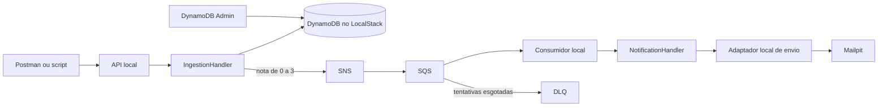

# Capítulo: como executar e testar a aplicação localmente

Este capítulo explica como testar a ingestão de feedback, conferir a gravação no banco e
acompanhar a notificação crítica até uma caixa de e-mail local. O ambiente usa Docker Compose,
LocalStack, DynamoDB Admin e Mailpit. Não exige conta AWS, API Key, identidades SES ou secrets
do GitHub. As credenciais `test` são fictícias e ficam restritas aos serviços locais.

## 1. O que foi implementado

| Componente | Responsabilidade |
|---|---|
| Ingestão | Validar o JSON, gerar ID/data/urgência, gravar no DynamoDB e publicar feedbacks críticos no SNS |
| API Java local | Disponibilizar o mesmo `IngestionHandler` por HTTP na porta 3000 |
| LocalStack | Emular DynamoDB, SNS e SQS; criar recursos pelo script `local/init-aws.sh` |
| Consumidor local | Ler a fila, chamar o `NotificationHandler` do Conrado e apagar somente mensagens processadas com sucesso |
| Adaptador Mailpit | Capturar a mensagem de e-mail montada pelo handler, substituindo o transporte SES apenas no modo local |
| Mailpit | Permitir a leitura dos e-mails de teste no navegador |
| DynamoDB Admin | Permitir a consulta visual da tabela e dos registros locais |



O código de produção da notificação não foi substituído: o consumidor chama seu handler.
As classes de execução local ficam em `src/local/java` e só entram no build com o profile
Maven `local`, usado pelos Dockerfiles de desenvolvimento.

## 2. Pré-requisitos

- Docker Desktop instalado e aberto, com suporte a containers Linux.
- Docker Compose disponível pelo comando `docker compose`.
- Terminal aberto na raiz do repositório, onde está `compose.local.yaml`.
- Postman ou outro cliente HTTP para os testes manuais.

Para rodar pelo Compose, Java, Maven, SAM e AWS CLI não precisam estar instalados no computador:
o build é feito nas imagens Docker. A primeira execução precisa de internet para baixar
imagens e dependências; as requisições da aplicação vão para os serviços locais.

No Windows, prefira o PowerShell. Confira:

```powershell
docker version
docker compose version
```

Se usar WSL, habilite sua distribuição em **Docker Desktop → Settings → Resources → WSL Integration**,
aplique a configuração e reabra o terminal. Em Linux/macOS, antes da primeira execução:

```sh
chmod +x local/init-aws.sh
```

## 3. Subir e conferir o ambiente

Execute na raiz do projeto:

```sh
docker compose -f compose.local.yaml up -d --build
docker compose -f compose.local.yaml ps
```

Devem aparecer cinco serviços: `api`, `localstack`, `notification`, `mailpit` e `dynamodb-admin`.
Aguarde o LocalStack ficar saudável. Ele inicializa a tabela, o tópico, a fila principal,
a inscrição SNS → SQS e a fila de falhas. Os demais serviços que dependem dele iniciam depois.

| Endereço | Método/uso |
|---|---|
| http://localhost:3000/health | GET no navegador; retorna `{"status":"local"}` |
| http://localhost:3000/avaliacao | POST no Postman ou script; recebe a avaliação |
| http://localhost:8001 | Interface gráfica do DynamoDB |
| http://localhost:8001/tables/tc4-local-feedbacks | Acesso direto à tabela de avaliações |
| http://localhost:8025 | Caixa de e-mails de teste do Mailpit |
| http://localhost:4566/_localstack/health | GET para consultar os serviços do emulador |

Abrir `/avaliacao` na barra do navegador faz um GET e retorna 405. Para enviar feedback,
use POST. Os serviços publicados no computador estão vinculados a `127.0.0.1`.

## 4. Fazer três testes pelo Postman

Configure uma requisição:

1. Método **POST** e URL `http://localhost:3000/avaliacao`.
2. Em **Body**, selecione **raw → JSON**.
3. Confira o header `Content-Type: application/json`.
4. Não é necessário informar `x-api-key` no ambiente local.

Envie os três corpos abaixo, separadamente:

**Teste 1 — avaliação crítica:**

```json
{"descricao":"Teste Pedro 1 - aula com audio inaudivel","nota":2}
```

**Teste 2 — avaliação normal:**

```json
{"descricao":"Teste Pedro 2 - boa explicacao","nota":8}
```

**Teste 3 — limite superior de nota:**

```json
{"descricao":"Teste Pedro 3 - excelente aula","nota":10}
```

| Teste | HTTP esperado | No banco | Notificação |
|---|---|---|---|
| Nota 2 | 201 | `rating = 2`, `urgency = ALTA` | Um e-mail no Mailpit |
| Nota 8 | 201 | `rating = 8`, `urgency = NORMAL` | Não deve gerar e-mail |
| Nota 10 | 201 | `rating = 10`, `urgency = NORMAL` | Não deve gerar e-mail |

Cada resposta contém `id`, `descricao`, `nota`, `urgencia` e `dataEnvio`. Guarde o `id` para
correlacionar a requisição com o banco, os logs e o e-mail. Cada novo POST válido gera outro ID;
repetir um teste cria mais uma avaliação.

### Alternativa pelo PowerShell

```powershell
$body = @{ descricao = 'Teste local - aula sem audio'; nota = 2 } | ConvertTo-Json
Invoke-WebRequest -UseBasicParsing -Method Post -Uri 'http://localhost:3000/avaliacao' `
  -ContentType 'application/json; charset=utf-8' -Body ([Text.Encoding]::UTF8.GetBytes($body))
```

### Alternativa pelo Bash/WSL

```sh
curl -i -X POST http://localhost:3000/avaliacao -H 'Content-Type: application/json' -d '{"descricao":"Teste local - aula sem audio","nota":2}'
```

## 5. Conferir os dados no DynamoDB

### Pela interface gráfica

Abra **http://localhost:8001**, clique em **tc4-local-feedbacks** e visualize os itens.
Procure as descrições dos testes ou o ID retornado pela API. Se a página já estava aberta,
atualize-a depois do envio.

| Campo salvo | Significado |
|---|---|
| `id` | ID retornado pela API |
| `description` | Valor de `descricao`, sem espaços nas extremidades |
| `rating` | Valor numérico de `nota` |
| `urgency` | `ALTA` para notas de 0 a 3; `NORMAL` para notas de 4 a 10 |
| `createdAt` | Instante de envio em UTC |
| `pk` | `DAY#yyyy-MM-dd`, calculado no dia de Brasília |
| `sk` | Instante UTC seguido de `#` e UUID |

A chave primária é composta por **`pk + sk`**. Várias avaliações do mesmo dia têm a mesma
`pk`; cada combinação com `sk` identifica um item. O dia de `createdAt` em UTC pode ser
diferente do dia local de Brasília usado na `pk`.

### Pelo terminal do projeto

Listar avaliações:

```sh
docker compose -f compose.local.yaml exec localstack awslocal dynamodb scan --table-name tc4-local-feedbacks --consistent-read
```

Mostrar os campos principais como tabela:

```sh
docker compose -f compose.local.yaml exec localstack awslocal dynamodb scan --table-name tc4-local-feedbacks --projection-expression "description,rating,urgency,createdAt" --output table
```

Contar registros:

```sh
docker compose -f compose.local.yaml exec localstack awslocal dynamodb scan --table-name tc4-local-feedbacks --select COUNT --consistent-read
```

O total inclui execuções anteriores e os scripts automáticos; não existe uma quantidade
fixa esperada. No JSON bruto do DynamoDB, `S` indica texto e `N` indica número.

### Pelo Docker Desktop, sem usar o terminal do Windows/WSL

Expanda **tc4-local**, abra o container **localstack**, selecione **Exec** e execute:

```sh
awslocal dynamodb scan --table-name tc4-local-feedbacks --projection-expression "description,rating,urgency,createdAt" --output table
```

O DynamoDB Admin e esses comandos consultam a mesma tabela local. Ela não aparece no console
da AWS e não pode ser aberta no Studio 3T, que é uma ferramenta para MongoDB.

## 6. Conferir o e-mail de urgência

Depois de enviar nota de 0 a 3, abra **http://localhost:8025**. Localize o assunto
`[Feedback crítico] Urgência ALTA - nota 2` ou pesquise pelo ID da avaliação.

O e-mail deve conter descrição, nota, urgência, data de envio no horário de Brasília e ID.
O remetente de teste é `feedback@tc4.test`, e o destinatário é `admin@tc4.test`.
Esses endereços não recebem e-mail fora do Mailpit. Aguarde alguns segundos para o consumo
assíncrono; em caso de falha anterior, a mensagem pode estar aguardando uma nova tentativa.

Confira o processamento pelo log:

```sh
docker compose -f compose.local.yaml logs --tail 50 notification
```

Procure `Notification sent` e o mesmo `feedbackId` da resposta da API.
O consumidor remove a mensagem da SQS após o sucesso: uma fila vazia depois do envio pode
significar que ela já foi processada. O e-mail permanece visível no Mailpit enquanto seus
dados estiverem disponíveis.

## 7. Testar entradas inválidas

Repita o POST com os seguintes corpos:

| Corpo | Resultado esperado |
|---|---|
| `{"descricao":"Teste","nota":11}` | 400: nota fora do intervalo |
| `{"descricao":"Teste","nota":-1}` | 400: nota fora do intervalo |
| `{"descricao":"Teste","nota":"2"}` | 400: nota enviada como texto |
| `{"descricao":"Teste","nota":2.5}` | 400: nota não inteira |
| `{"descricao":"   ","nota":2}` | 400: descrição vazia |
| `{"nota":2}` | 400: descrição ausente |
| `{` | 400: JSON malformado |

Esses casos devem retornar `codigo = ENTRADA_INVALIDA` e uma `mensagem` explicativa,
sem criar avaliação no banco ou gerar e-mail. A descrição aceita até 1000 caracteres.
Se quiser comparar a contagem antes/depois, não execute outros envios em paralelo.

## 8. Executar os testes automáticos

### Scripts de teste da API e da notificação

Com o Compose ativo, execute no PowerShell, na raiz do projeto:

```powershell
powershell -NoProfile -ExecutionPolicy Bypass -File .\local\test-api.ps1
powershell -NoProfile -ExecutionPolicy Bypass -File .\local\test-notification.ps1
```

O primeiro script confere HTTP 201/400, classificação de urgência e gravação dos IDs no
DynamoDB local. O segundo espera o e-mail crítico no Mailpit, verifica seu conteúdo e
confere a ausência de e-mail para a avaliação normal durante a janela do teste.
Ambos criam dados sintéticos e encerram com erro se alguma verificação falhar.
Não apagam as avaliações e os e-mails criados.

### Suíte Java da ingestão

Para executar o Maven diretamente no computador, são necessários **JDK 21 e Maven**.

```sh
mvn -f functions/ingestion/pom.xml test
mvn -f functions/ingestion/pom.xml verify -Pintegration
```

A suíte contém 31 casos unitários e 3 de integração. O profile `integration` exige o
LocalStack ativo na porta 4566 e cria recursos temporários próprios, separados da tabela
da API. Ele usa SDKs com credenciais fictícias e remove seus recursos após os testes.
Os testes unitários não precisam de Docker. Detalhes em [ingestão de feedback](ingestao-feedback.md).

## 9. Inspecionar a fila antes do consumo

Pare somente o consumidor:

```sh
docker compose -f compose.local.yaml stop notification
```

Envie uma avaliação crítica pela API e depois leia a fila:

```sh
docker compose -f compose.local.yaml exec localstack awslocal sqs receive-message --queue-url http://localhost:4566/000000000000/tc4-local-notification --wait-time-seconds 2
```

O `Body` deve conter `id`, `descricao`, `nota`, `urgencia` e `dataEnvio`.
Receber manualmente a mensagem aumenta sua contagem de recebimentos e a deixa temporariamente
invisível; isso também interfere nas tentativas disponíveis. Para retomar:

```sh
docker compose -f compose.local.yaml start notification
```

## 10. Simular falha, retry e DLQ

O consumidor confirma apenas as mensagens que o handler processou com sucesso. As que
falham voltam a ficar disponíveis após o timeout de visibilidade. Localmente, esse timeout
é de **20 segundos**, e o redrive permite **3 recebimentos** antes do encaminhamento à DLQ.
O fluxo depende do polling e não tem um tempo total exato garantido.

Para testar uma falha de envio:

1. Pare o Mailpit:

   ```sh
   docker compose -f compose.local.yaml stop mailpit
   ```

2. Envie uma avaliação com nota 2.
3. Acompanhe `docker compose -f compose.local.yaml logs -f notification` e procure
   `Notification failed`, `feedbackId` e o aumento de `receiveCount`. Ctrl+C encerra apenas
   o acompanhamento dos logs.
4. Depois das tentativas, consulte a fila de falhas:

   ```sh
   docker compose -f compose.local.yaml exec localstack awslocal sqs receive-message --queue-url http://localhost:4566/000000000000/tc4-local-notification-dlq --wait-time-seconds 2
   ```

5. Reinicie o Mailpit:

   ```sh
   docker compose -f compose.local.yaml start mailpit
   ```

Se o Mailpit voltar antes de esgotar as tentativas, a mensagem ainda na fila principal
pode ser processada com sucesso. Uma mensagem já na DLQ não volta automaticamente:
exige reprocessamento. O ambiente local não tem o alarme CloudWatch da stack AWS.

## 11. Parar, retomar e entender a duração dos dados

Parar os serviços sem remover os containers:

```sh
docker compose -f compose.local.yaml stop
```

Retomar e reconstruir caso haja alterações de código:

```sh
docker compose -f compose.local.yaml up -d --build
```

Não há volume de persistência configurado para os dados do LocalStack ou do Mailpit.
Não conte com a retenção dos registros e mensagens após reinícios/recriações. Registre as
evidências necessárias antes de parar o ambiente. A estrutura do banco e da mensageria é
recriada automaticamente pelo script de inicialização.

Para remover os containers e a rede do ambiente local, descartando seus dados temporários:

```sh
docker compose -f compose.local.yaml down
```

Esse comando é opcional; não o use quando quiser apenas consultar os dados existentes.

## 12. Solução dos problemas encontrados

| Sintoma | O que verificar |
|---|---|
| `docker could not be found in this WSL 2 distro` | Habilitar WSL Integration para sua distribuição ou executar o comando no PowerShell do Windows |
| `Docker Desktop is unable to start` / `HCS_E_CONNECTION_TIMEOUT` | Reiniciar o Docker e o WSL conforme os passos abaixo |
| Porta já em uso | Conferir se há outro ambiente usando 3000, 4566, 8001 ou 8025; não iniciar o LocalStack avulso junto do Compose |
| API retorna 405 | Usar POST no Postman em vez de abrir `/avaliacao` no navegador |
| API retorna 503 | Conferir LocalStack e logs da API; se `persistido = true`, o banco salvou, mas a publicação do alerta não foi confirmada |
| DynamoDB Admin não mostra tabela | Conferir `localstack` saudável, logs de `dynamodb-admin` e se a interface aponta para `localstack:4566` |
| Nota baixa não gera e-mail | Conferir `notification` e `mailpit`, logs, mensagens aguardando retry e DLQ |
| A fila aparece vazia | Conferir o Mailpit e `Notification sent`; o consumidor pode já ter processado o evento |
| Banco vazio depois de reiniciar | Dados são temporários; execute novamente os testes |

No erro de timeout do WSL, feche os trabalhos abertos nos terminais Linux. Os comandos abaixo
reiniciam as distribuições WSL e interrompem os serviços locais. No PowerShell do Windows:

```powershell
docker desktop stop
wsl --shutdown
docker desktop start
docker compose -f compose.local.yaml up -d
```

Depois confira `/health`, abra o banco e rode os scripts novamente. Esse procedimento
recuperou o ambiente durante os testes do projeto; não é uma garantia de corrigir toda
falha de inicialização. Referências: [Docker com WSL](https://docs.docker.com/desktop/features/wsl/)
e [comandos WSL](https://learn.microsoft.com/windows/wsl/basic-commands).

## 13. O que está validado e o que depende da integração em nuvem

Durante o desenvolvimento foram verificados: HTTP 201 para avaliações válidas, HTTP 400
para entradas inválidas, gravação e consulta pelo ID no DynamoDB, exibição dos registros
no DynamoDB Admin, entrega de evento crítico SNS → SQS, execução do handler da notificação,
captura do e-mail no Mailpit e encaminhamento de mensagem inválida à DLQ após as tentativas.
As saídas históricas e prints dessas execuções não foram versionados como um relatório de
evidências; os scripts permitem repetir as verificações descritas.

Este ambiente não executa o relatório semanal, o agendamento EventBridge, IAM, a validação
do API Gateway, suas API Keys/quotas, a Lambda gerenciada nem o SES real. A regra de negócio
é compartilhada, mas o transporte HTTP e o consumidor são adaptadores de desenvolvimento.
O teste ponta a ponta local cobre **feedback → banco/evento → notificação**, não o sistema
completo com relatório semanal. A homologação em AWS continua necessária para a entrega.

## 14. Relação com o GitHub Actions

| Workflow | Comportamento |
|---|---|
| `ingestion-tests.yml` | Executa testes Java unitários e de integração com LocalStack em pushes/PRs que correspondam aos filtros de arquivos do workflow |
| `deploy.yml` | Faz build/deploy da stack `tc4-dev` na AWS, em push na `main` ou disparo manual, se os acessos estiverem configurados |

Os scripts PowerShell e o Compose completo com Mailpit/DynamoDB Admin são executados
localmente; o workflow de testes atual não executa esses scripts nem o consumidor local.
Os workflows são separados, e o deploy não espera automaticamente pelo resultado da suíte
de testes. Publicar uma branch de funcionalidade para revisão não aciona o deploy configurado
para a `main`; um merge na `main` ou disparo manual de `Deploy` pode usar a AWS real.

Para revisão em equipe, registre no PR os testes executados e, quando necessário, anexe a
resposta 201, o registro com o mesmo ID no banco, o e-mail e os logs correlacionados.
